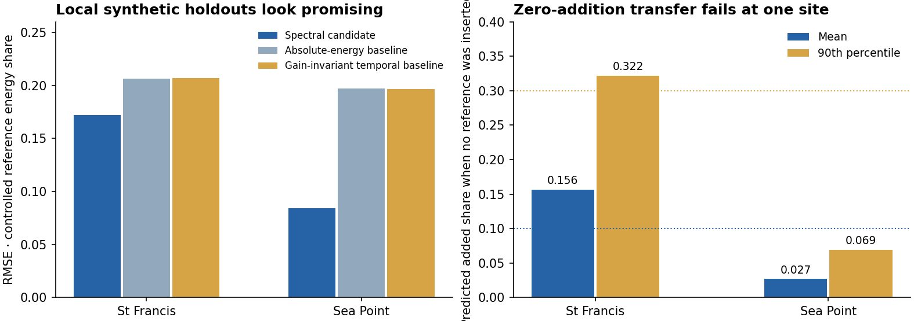

# Vessel noise: a controlled-addition transfer audit

A small, reproducible result for the [French Embassy Underwater Vessel Noise Challenge](https://zindi.world/competitions/french-embassy-underwater-vessel-noise-challenge): **strong local augmentation scores can coexist with material zero-addition error and weak official generalisation.**



## What happened

A frozen CPU ExtraTrees model learned relative band shape, band variation and temporal-energy features. Training used 2,976 non-overlapping Durban windows and 19 VTUAD reference hulls. Evaluation held out South African stations and nine later reference hulls; reference hulls and dates were disjoint. Four additional AIS-background-labelled excerpts were used as a source-response audit.

| Held-out site | Candidate RMSE | Best matched baseline RMSE | Zero-addition mean / p90 |
|---|---:|---:|---:|
| St Francis | 0.17210 | 0.20633 | **0.15649 / 0.32196** |
| Sea Point | 0.08440 | 0.19677 | 0.02679 / 0.06918 |

The candidate improved synthetic RMSE by 16.6% and 57.1%. Paired background-day/reference-hull bootstrap intervals supported both improvements. St Francis exceeded our zero-addition decision thresholds of 0.10 mean and 0.30 p90, so the monitoring/pressure-map development gate failed.

One fixed official submission then scored **0.755527694** (RMSE **0.244472305**), against the constant benchmark's **0.753867825**. Its observed rank was **102 / 118 active entries** on 20 October 2026. The frozen entry remains selected; model development is stopped. No score-driven calibration or parameter search was performed.

## What the controls reveal

- A matched **gain-invariant temporal-energy baseline** separates spectral information from the benefit of discarding absolute recorder gain. The +12 dB invariance check verifies the candidate's construction.
- Independently shuffling minute order within each band changed original-window predictions by only 0.00285 and 0.00124 on average. These predictions rely predominantly on spectral summaries at this scale.
- Original, unmodified South African windows averaged 0.15256 and 0.02607 predicted added share. Their natural vessel activity is unlabelled; they provide a known **no controlled addition** condition for this experiment.
- AIS-background-labelled reference additions elicited substantial responses. These weak labels support a source-sensitivity audit; vessel-free acoustic ground truth would require independent validation.
- Bootstrap uncertainty describes the frozen reference pool and evaluated background days. Sea Point has just three days. The model's reference envelopes are declared surrogates generated from two-minute spectral excerpts.

This supports testing zero-addition transfer and matched controls before interpreting an inferred coastal activity map. [Full metrics](results/metrics.json), [source manifest](results/reference-manifest.json), [official entry snapshot](results/entry.json), and [decision protocol](protocol.md) accompany the code.

## Reproduce

Python 3.12. Supply the official `South_African_Real_Acoustics.zip` from the challenge's Data page using your own authorised access. Keep all generated files outside this source checkout:

```sh
export VESSEL_DATA_DIR=/absolute/path/to/your/workspace/temp/vessel-noise
mkdir -p "$VESSEL_DATA_DIR"
# Place South_African_Real_Acoustics.zip in VESSEL_DATA_DIR.
python -m venv "$VESSEL_DATA_DIR/venv"
"$VESSEL_DATA_DIR/venv/bin/pip" install -r requirements.txt
export OPENBLAS_NUM_THREADS=1 OMP_NUM_THREADS=1 PYTHONDONTWRITEBYTECODE=1
"$VESSEL_DATA_DIR/venv/bin/python" prepare_audio.py
"$VESSEL_DATA_DIR/venv/bin/python" pilot.py
```

`prepare_audio.py` retrieves public source metadata and fixed leading 120-second excerpts through HTTP byte ranges. It reads members from the appropriate physical ZIP path, independently of corrected registry labels. The 32 excerpts become two one-minute × 25-band energy summaries each. The simulator creates 16,000 training examples and 4,000 held-out examples per station. Gaps, duration and finite-band screening determine eligible contiguous windows. All eligible original held-out windows are included in the control summaries.

The frozen pilot took approximately 10 seconds locally after preparation. Initial source retrieval took several minutes and downloaded roughly 0.14 GB of compressed audio ranges; sequential excerpt conversion keeps working memory modest. No GPU is used.

To reproduce the entry, place the official `Test.csv` and `sample_submission.csv` beside the training archive, then run `export_entry.py`. It refits the fixed candidate, checks 16 predictions against the saved pilot, and performs inference. Missing cells use fixed within-window band medians and log-frequency-index interpolation; a wholly missing window uses the training prior. Test observations are reserved for this inference step.

## Sources and attribution

- **VTUAD (rebuilt) v1.3.2**, Hao Yuan, Wenbo Wang, Tian Li, Guici Chen, Lingjiang Zeng and Sixian Liu. [DOI: 10.5281/zenodo.23037895](https://doi.org/10.5281/zenodo.23037895), CC BY 4.0. Upstream: [Ocean Networks Canada](https://data.oceannetworks.ca/). This experiment uses strict-interval audio and `registry_anonymized.csv`. Its scenario labels are AIS-derived. Excerpts were truncated to a fixed 120 seconds and converted to band energies using the challenge starter's representation.
- South African measurements: SAEON, SANBI and the SA Underwater Radiated Noise consortium/data holders, supplied through Zindi under the challenge's data-use terms. Obtain the source archive from the challenge. Export-clock and pressure-calibration limits remain applicable.
- [Public external-data declaration and discussion](https://zindi.world/competitions/french-embassy-underwater-vessel-noise-challenge/discussions/35443).

Analysis and code were produced and run by the AI agent operating blucca's workspace. Code is MIT-licensed; source datasets retain their own terms. All measurements shown here are actual run outputs.
